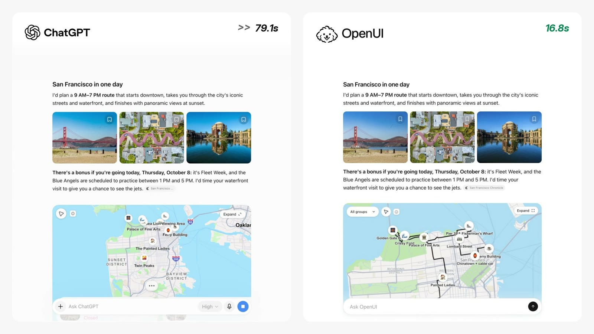

# Open Intelligent UI

**An open-source implementation of the "Intelligent UI" experience introduced in ChatGPT, built on [OpenUI](https://openui.com).**

**[Try the live demo](https://www.openui.com/demo/intelligent-ui)**

In ChatGPT's Intelligent UI, a request such as "plan a day in San Francisco" returns an interactive answer (a map, photographs and an editable itinerary) rather than text. This repository reproduces that experience with open-source components, so that the same kind of interface can be built, modified and shipped inside any application.

[OpenUI](https://github.com/thesysdev/openui) is an open standard for Generative UI.

> This project is independent and is not affiliated with or endorsed by OpenAI. "Intelligent UI" refers to the ChatGPT feature that this demo recreates.

## Demo video

ChatGPT's Intelligent UI (left) and this project (right) answering the same request. Select the image to play the video.

[](docs/openui-chatgpt-comparison.mp4)

## What's in the demo

The model streams OpenUI Lang 1.0, and the app renders it with a library of primitives the model arranges itself: no layout is fixed in the components. The library (`src/lib/library.ts`, components in `src/lib/components/`) follows the Open Intelligent UI design. The components have light and dark tokens, but only `/gallery` (and the benchmark's `/preview`) switch to dark; the chat is light only:

- **Layout:** `Col`, `Row`, `Box` (background, radius, border, sizes, flex), `Grid`, `Card`, `Carousel` (a scrolling, snapping row), `Popover`, `Divider`, `Spacer`.
- **Text:** `Title`, `Text` (inline **bold**, *italic*, `code`, links), `Caption`, `Label`, `Badge`, `Link`, `List` and `ListItem` (bullets, numbers, a timeline), `Markdown`.
- **Inputs:** `Button`, `IconButton`, `Pressable`, `Input`, `TextArea`, `Select`, `SegmentedControl`, `Slider`, `Checkbox`, `RadioGroup`, `DatePicker`, `Timer` (a countdown), `Form`. Each input's first argument is its value, usually a `$variable` other statements read.
- **Media and data:** `SearchImage` (a photo the app finds for a query, like ChatGPT's server-resolved images), `Image` (a given URL), `Icon` (lucide names), `Table` (cells may be components), `Chart` (bar, line, area, pie, donut, scatter), `Map` with `MapMarker` ([MapLibre GL](https://maplibre.org), category filter, expansion, a street route), and `YouTube`.
- **More text and play:** `Text` takes a list mixing strings and inline components; `Quote`, `Code` (with copy) and `Math` (KaTeX); `Flashcard` (flips) and `Celebration` (confetti when a condition turns true).
- **Drawing:** `Svg` with `G`, `Circle`, `Ellipse`, `Rect`, `Line`, `Path`, `Polyline`, `Polygon` and `SvgText`, whose attributes take expressions so state can move them; `HtmlView` runs an HTML page (a game, a canvas) in a sandboxed iframe.

- **Functions:** 59 generic `@functions` (`src/lib/functions/`) next to the 1.0 built-ins, so an answer can compute with its own state: lists (`@Append`, `@Remove`, `@Update`, `@Toggle`, `@Includes`, `@Range`, `@Chunk`, `@Shuffle`, ...), numbers (`@Pow`, `@Random`, `@Clamp`, `@Percent`, `@Allocate` for splits that add up to the cent, `@Payment` for loans, `@Convert` for units), text (`@Format`, `@Join`, `@Split`, `@Replace`, `@Capitalize`, `@Plural`, `@Duration`, `@Default`), colors (`@MixColor`), dates (`@Today`, `@FormatDate`, `@AddDays`, `@AddMonths`, `@DaysBetween`, `@MonthsBetween`, `@StartOf`) and data for dashboards (`@GroupBy`, `@Pivot`, `@Top`, `@Between`, `@Bucket`, `@Cumulative`, `@MovingAvg`, `@Change`, `@Histogram`, `@Stats`). A bad argument makes a call evaluate to null, as in 1.0.
- **Actions:** `@CopyToClipboard(text)`, for copying a shopping list or a split.

The dev-only page `/gallery` renders hand-written programs: a working answer for each of the 16 Intelligent UI examples (from the 7-speed bike to the arcade game), two dashboards over demo data, the prompt's worked examples, and programs that exercise every component.

## Setup

Requires Node 24.

```bash
cp .env.example .env
npm install
npm run generate:apiKey   # writes THESYS_API_KEY to .env
npm run dev
```

Open http://localhost:3000 and try: `I'm in San Francisco for a day, plan a sightseeing route for me`

| Variable | Required | Purpose |
| --- | --- | --- |
| `THESYS_API_KEY` | Yes, unless using a direct API | OpenUI Cloud (Gateway) key, used only on the server. |
| `THESYS_MODEL` | No | A `{provider}/{model}` id. Defaults to `openai/gpt-6.1-sol`. |
| `THESYS_BASE_URL` | No | The Gateway's Responses endpoint. Defaults to `https://api.thesys.dev/v1/embed`. |
| `LLM_BASE_URL` | No | Use any OpenAI-compatible Chat Completions API directly instead of Cloud, e.g. `https://openrouter.ai/api/v1`; see [Use any OpenAI-compatible API](#use-any-openai-compatible-api). |
| `LLM_API_KEY` | With `LLM_BASE_URL` | That API's key. |
| `LLM_MODEL` | With `LLM_BASE_URL` | The model id it serves, e.g. `openai/gpt-6.1-sol` on OpenRouter. |
| `LLM_REASONING_EFFORT` | No | Reasoning effort for both paths. Defaults to `low` (about five times faster to the first line of UI on gpt-6.1-sol, same quality); `default` sends none. |
| `MODEL_PROVIDER` | No | Set to `ollama` to run a local model instead of Gateway; see [Run with a local model](#run-with-a-local-model-ollama). |
| `OLLAMA_MODEL` | No | The Ollama model to use. Defaults to `qwen3.8:27b`. |
| `OLLAMA_BASE_URL` | No | Ollama's OpenAI-compatible endpoint. Defaults to `http://localhost:11434/v1`. |

## Use any OpenAI-compatible API

Set `LLM_BASE_URL`, `LLM_API_KEY` and `LLM_MODEL` to skip OpenUI Cloud and call a model directly, for example through OpenRouter:

```bash
LLM_BASE_URL=https://openrouter.ai/api/v1
LLM_API_KEY=sk-or-...
LLM_MODEL=openai/gpt-6.1-sol
```

`/api/chat` then builds the full OpenUI 1.0 system prompt on the server, from the same library spec and prompt options (`generateSystemPrompt`), streams Chat Completions and relays the text as Responses events, so the browser is unchanged. The Ollama variables below are shortcuts for the same path. Output is rendered as written: Cloud's correction step is not there.

## Run with a local model (Ollama)

The demo can also run on a local model through [Ollama](https://ollama.com), with no API key required.

It works with any OpenAI-compatible local server (Ollama, LM Studio) via `OLLAMA_BASE_URL`.

1. Install Ollama and pull a model. The default is `qwen3.8:27b` (about 18 GB, best with 32 GB of memory or more); `gpt-oss:20b` and `qwen3:8b` are smaller alternatives.

   ```bash
   ollama pull qwen3.8:27b
   ```

2. Give the model a larger context window. The OpenUI prompt for this app is about 8,000 tokens, and Ollama's default window is 4,096, which silently cuts the prompt and produces broken output. Either start Ollama with a larger default:

   ```bash
   OLLAMA_CONTEXT_LENGTH=32768 ollama serve
   ```

   or create a model variant with a larger window and use its name as `OLLAMA_MODEL`:

   ```bash
   printf 'FROM qwen3.8:27b\nPARAMETER num_ctx 32768\n' > Modelfile
   ollama create qwen3.8-32k -f Modelfile
   ```

3. In `.env`, set `MODEL_PROVIDER=ollama` (and `OLLAMA_MODEL` to use another model), then `npm run dev`.

What changes with a local model:

- **No output correction.** Gateway validates and corrects the generated OpenUI Lang; locally, the model's output is rendered as written, so larger models give better results.
- **Speed depends on your hardware.** The first request after Ollama loads the model has to read the whole prompt; later requests reuse it and are much faster. For reasoning models, `LLM_REASONING_EFFORT=low` cuts the wait considerably. 
## How it works

- **Generation.** `/api/chat` calls OpenUI Gateway's Responses API with `generateSystemPrompt({ cloud: true })`, so Gateway validates and corrects the generated OpenUI Lang against this app's component library. No search tool is sent: `SearchImage` finds its own photo (see Photos below), so the model never announces a search that shows nothing. Requests ask for low reasoning effort (`LLM_REASONING_EFFORT`).
- **Chat Completions.** OpenUI Gateway also supports the Chat Completions API, and OpenUI works with either. This example uses the Responses API because Gateway's hosted tools are available only there. An application already built on Chat Completions can keep that protocol and pair it with `openAIReadableStreamAdapter` or `openAIAdapter` in the browser.
- **State.** Inputs bind to `$variables` (`Slider($price, 0, 100)`), and any statement that reads them updates as the user interacts. Buttons and `Pressable` run `@Set`, `@Reset`, `@ToAssistant`, `@OpenUrl` and `@CopyToClipboard` steps.
- **Working tools.** The prompt options in `src/lib/prompt-options.ts` (rules and worked examples) teach the model to answer with a tool that works in the page: lists and inputs live in `$variables`, everything shown is computed from them with `@functions`, and buttons change them with `@Set`, instead of sending a form back to the assistant. `@Each` maps a list into rows, e.g. `@Each(@Range(0, $years + 1), "y", {year: y, balance: $p * @Pow(1 + $r / 100, y)})`.
- **Photos.** `SearchImage` (and `Image` when its URL fails) asks `/api/wiki` for the lead photo of the Wikipedia article titled like the query, then `/api/image-search` for Wikipedia and Wikimedia Commons results whose titles match it.
- **Threads.** Threads and messages, including what the user typed or ticked in an answer, are kept in the browser's localStorage (`src/lib/chat-storage.tsx`), so they survive switching threads and reloading.
- **Map data.** Street geometry comes from `/api/street-route`, which validates input and caches results from the public OSRM demo server's driving profile: a road overview, not walking or transit directions. When it's unavailable, a labelled direct connection is drawn instead.
- **Theme.** Colors, type, radii and spacing are tokens in `src/lib/components/theme.css`, with a dark set under `data-theme="dark"` that only `/gallery` and `/preview` use. The chat shell keeps its `AgentInterface` theme from `src/lib/response-theme.ts`.

## Project structure

| File | Purpose |
| --- | --- |
| `src/app/layout.tsx` | Root layout: page metadata, the Inter font and `globals.css`. |
| `src/app/page.tsx` | The chat page. Renders `AgentInterface` with the component library, theme, welcome screen and starter prompts, and connects it to `/api/chat`. |
| `src/app/globals.css` | Global CSS reset. |
| `src/app/shell.css` | Restyles the `AgentInterface` shell (sidebar, composer, starters, message bubbles), using theme tokens where they exist. |
| `src/app/api/chat/route.ts` | Chat endpoint. Validates the request, forwards the conversation to OpenUI Cloud (or, with `LLM_BASE_URL` or the Ollama variables, to any OpenAI-compatible API with the prompt built here), and streams the response back. |
| `src/app/api/street-route/route.ts` | Street geometry between stops from OSRM, cached on the server. |
| `src/app/api/wiki/route.ts` | Wikipedia lookup: the lead photos (and coordinates) of an article, cached on the server. |
| `src/app/api/image-search/route.ts` | Photo search for `SearchImage`: matching Wikipedia lead images, then Wikimedia Commons, cached on the server. |
| `src/app/gallery/` | The dev-only `/gallery` page and its OpenUI Lang programs; `tool-programs.ts` holds the 16 examples and the dashboards. |
| `src/app/preview/` | A dev-only page that renders one program handed in by a script, for the benchmark's screenshots. |
| `src/lib/library.ts` | The OpenUI component library: the primitives, their groups and prompt notes. |
| `src/lib/functions/` | The library's `@functions` (`defineFunction`), with tests that run them through the 1.0 parser and evaluator. |
| `src/lib/actions.ts` | The `@CopyToClipboard` action and its handler. |
| `src/lib/demo-data.ts` | Demo data tools (`get_orders`, `get_tickets`, `get_traffic`) for Query-backed dashboards: their specs for the prompt and a function-map tool provider. |
| `src/lib/prompt-options.ts` | The prompt options: the working-tool rules and examples, and a dashboard variant with the demo data tools. |
| `src/lib/response-theme.ts` | Theme tokens for the `AgentInterface` shell (colors, fonts, radii, chat bubbles), built with `createTheme()`. |
| `src/lib/components/` | The components (`defineComponent` + Zod schema each), their styles and tokens, and the map in `map/`. |
| `src/generated/spec.json` | Library spec sent to Gateway in the system prompt. Regenerate with `npm run generate` after changing a component schema. |
| `src/generated/system-prompt.txt` | The full system prompt for the library; `dashboard-system-prompt.txt` adds the demo data tools. Regenerate with `npm run prompt`. |
| `scripts/bench/` | The benchmark: 16 example prompts and 8 dashboard prompts, run against a model and checked; see [Benchmark](#benchmark). |
| `docs/openui-chatgpt-comparison.mp4` | Side-by-side video of ChatGPT and this project; `docs/openui-chatgpt-comparison.jpg` is its README preview. |
| `.env.example` | The environment variables to copy into `.env`. |

## For designers

`npm install && npm run dev`, then open http://localhost:3000/gallery. It needs no API key: every example and component renders from hand-written programs, with Light and Dark at the top right. Check phone width too.

- **Components** are in `src/lib/components/` (`layout.tsx`, `text.tsx`, `markdown.tsx`, `controls.tsx`, `media.tsx`, `chart.tsx`, `table.tsx`, `svg.tsx`, `html-view.tsx`, `map/`), styled by `components.css` (`iui-*` classes).
- **Tokens** (colors, type, radii, spacing) are in `src/lib/components/theme.css`, with the dark set under `[data-theme="dark"]`. The chat shell around answers is `src/app/shell.css` and `src/lib/response-theme.ts`.
- **`/gallery`** is the design surface: "Working tools" holds the 16 examples and two dashboards, "Components" one program per component.

How anything looks can change freely. What the model writes must keep working, so keep these as they are, or regenerate the prompt (`npm run generate && npm run prompt`) and tell whoever owns it:

- component and `@function` names, the order of their arguments, and option values such as Button's `"solid" | "outline" | "soft" | "ghost"`;
- the color names a model can use: `ink`, `muted`, `faint`, `surface`, `info`, `success`, `warning`, `danger`, `purple`, `pink`, `chart1` to `chart6`.

## Checks

```bash
npm run generate && npm run prompt   # after changing a component schema, a function or the prompt options
npm test                             # the functions, and every gallery program and prompt example parsed by the 1.0 parser
npm run typecheck
npm run build
```

Then open `/gallery` (`npm run dev`), switch between light and dark, and try it at phone width.

## Benchmark

`scripts/bench/run.mjs` sends the 16 example prompts (with `system-prompt.txt`) and 8 dashboard prompts (with `dashboard-system-prompt.txt`) to a model on any OpenAI-compatible endpoint, saves each answer, checks it with the 1.0 parser, flags `@names` and components the library does not have, and screenshots each answer in light and dark at 390 and 1280 px through `/preview`. The key is read from an environment variable at run time.

```bash
npm run dev   # in another terminal, for the screenshots
PLAYWRIGHT_CORE=/path/to/playwright-core CHROME=/path/to/chrome-headless-shell \
  OPENROUTER_API_KEY=... npm run bench -- --model <id> --base-url https://openrouter.ai/api/v1 --key-env OPENROUTER_API_KEY
npm run bench -- --fake                 # the hand-written programs stand in for the model
npm run bench -- --answers <dir>        # re-check and re-shoot saved <id>.oui answers
```

Results go to `bench-out/<model>-<time>/`: `answers/`, `shots/`, `report.json` and `report.md`. Other options: `--only id,id`, `--kind tool|dashboard`, `--widths`, `--no-shots`, `--concurrency`, `--temperature`, `--max-tokens`, `--app`.

